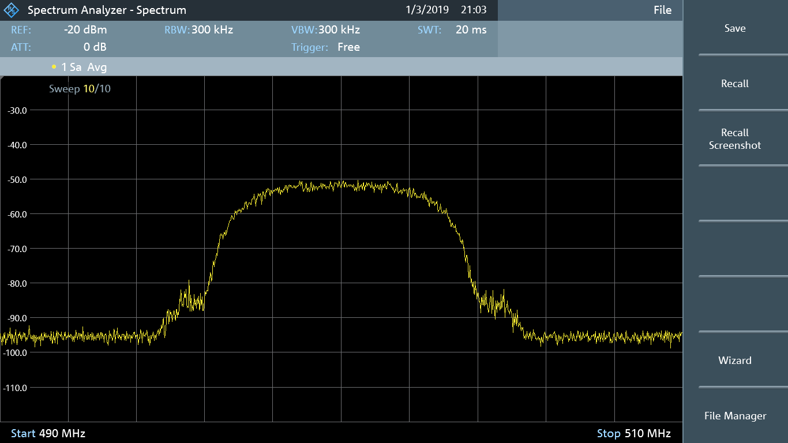
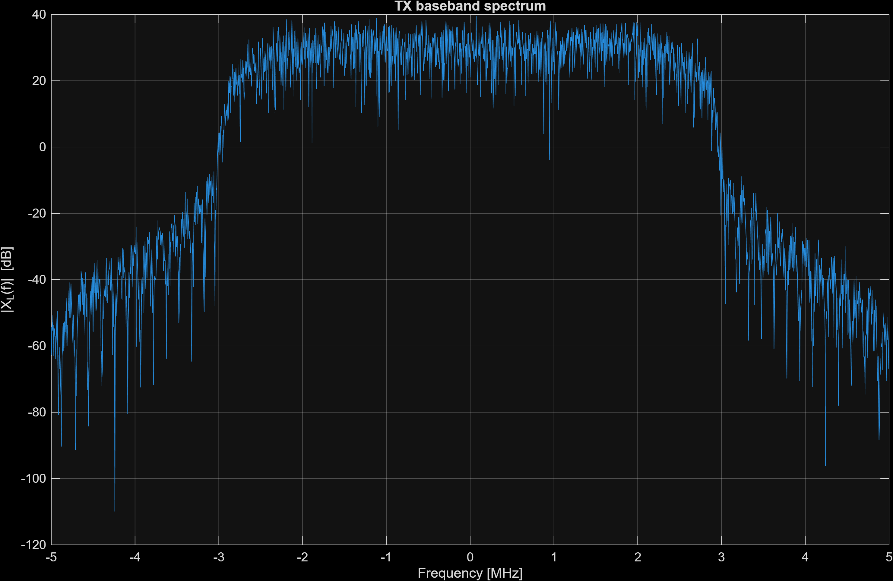
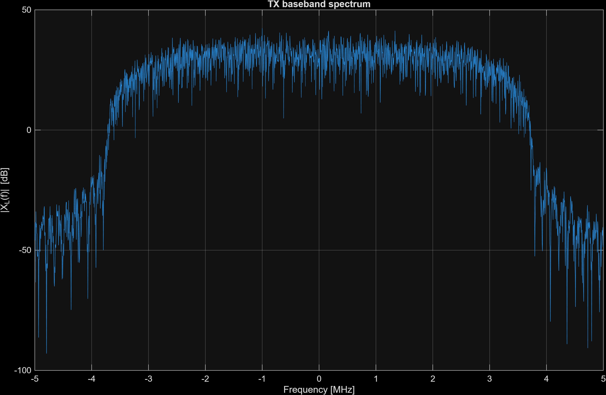
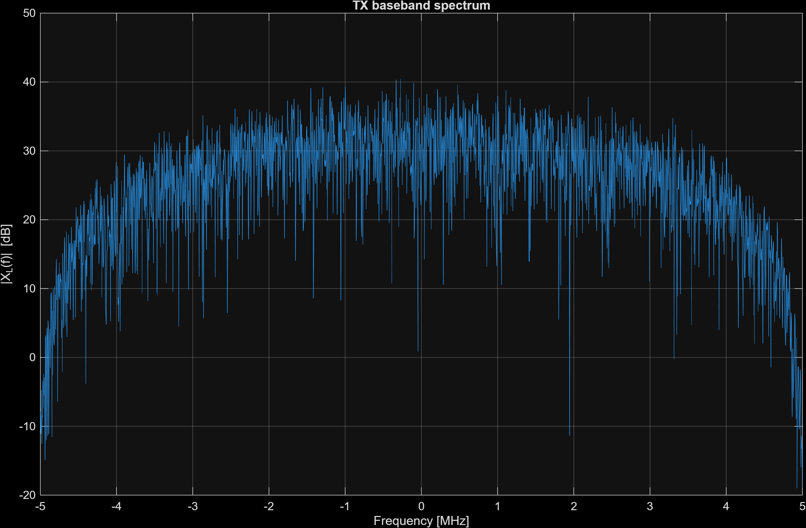
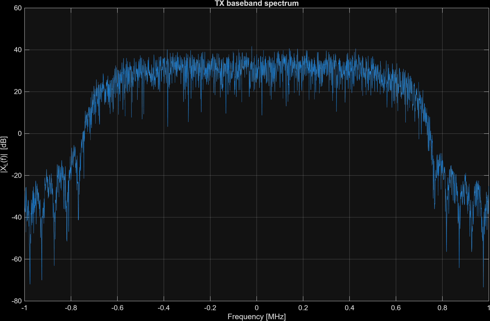
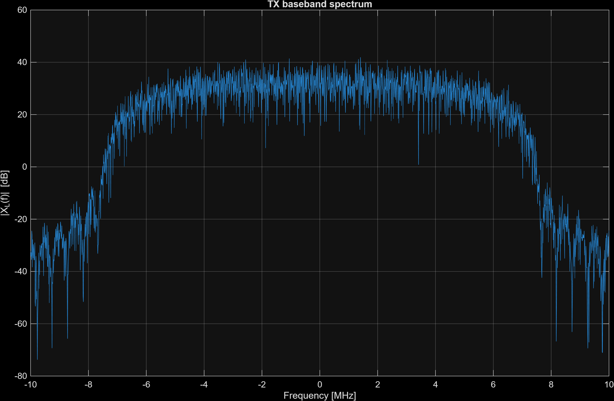
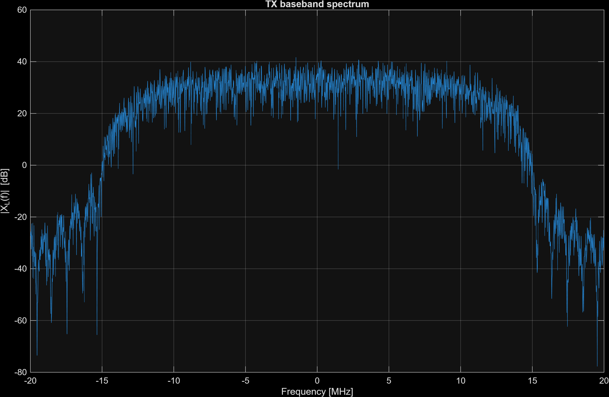
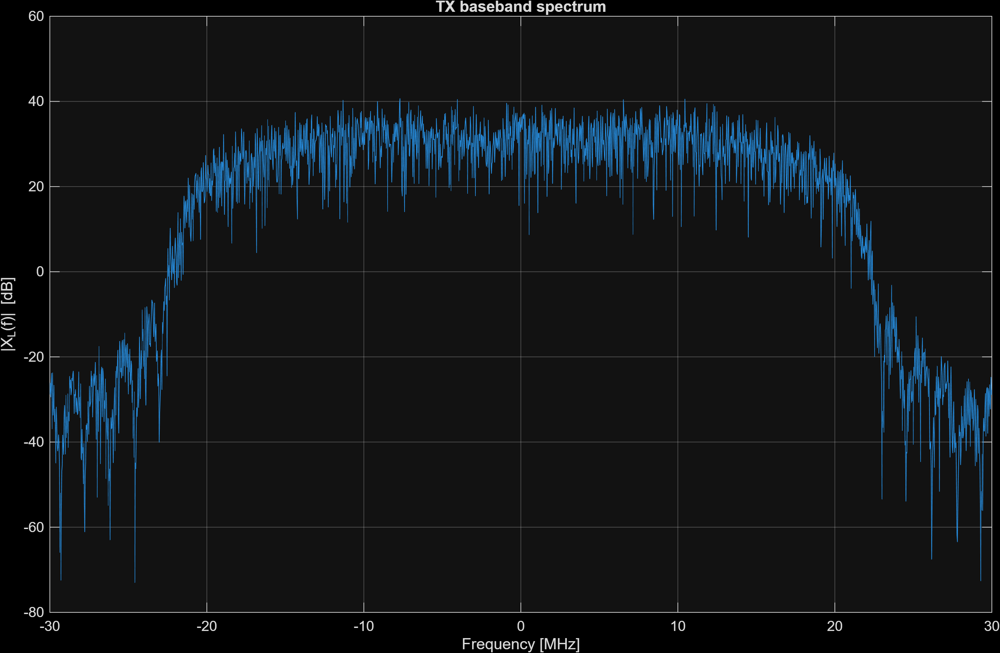
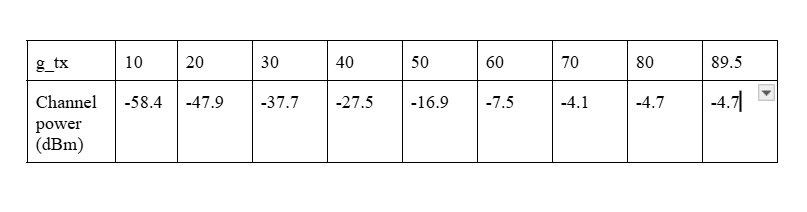
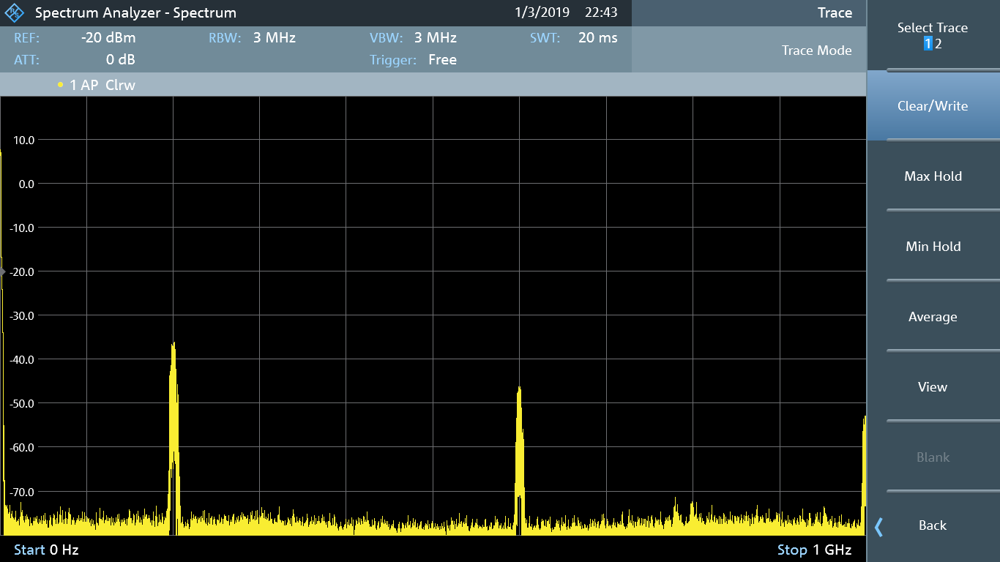

# 1. Objectif et matériel

L'objectif de la première session est d'implémenter, sur du matériel réel, la chaîne d'émission développée dans les LiveScripts de simulation. Le banc de mesure se compose de :

- un USRP **Ettus B210** (numéro de série `3241A58`),
- un **analyseur de spectre R&S** (mode *Spectrum*, RBW $30\,\text{kHz}$, VBW $3\,\text{MHz}$ par défaut),
- un PC sous MATLAB R2025b avec les drivers `usrpradio.mlpkginstall` et la *Communications Toolbox*.

La sortie **TX1** du B210 est connectée à l'analyseur ; la sortie **TX2** est terminée sur charge $50\,\Omega$ pour éviter toute réflexion susceptible d'endommager l'étage de sortie.

# 2. Chaîne d'émission

Le script [`projet.m`](../projet.m) génère un signal de modulation 16-QAM avec mise en forme par filtre **Root Raised Cosine** (RRC), puis pilote l'USRP en boucle infinie. Les étapes principales :

1. génération aléatoire de $N_b = N_d \cdot \log_2 M$ bits (avec $M = 16$, $N_d = 1000$ symboles de données et $N_p = 10$ symboles pilotes) ;
2. *mapping* QAM ;
3. concaténation `[symb_pilot ; symb_data]` ;
4. convolution avec la réponse impulsionnelle RRC ;
5. normalisation dans $[-1\,;\,+1]$ pour éviter la saturation du DAC ;
6. envoi vers l'USRP via l'objet `comm.SDRuTransmitter`.

## 2.1. Bande passante du signal

Pour un filtre RRC de débit symbole $R_s$ et de roll-off $\beta$, la bande occupée en bande de base est :

$$
\mathrm{BW} \;=\; R_s \,(1 + \beta)
$$

Avec $R_s = 5\,\text{MHz}$ et $\beta = 0{,}5$, on obtient $\mathrm{BW} = 7{,}5\,\text{MHz}$.

## 2.2. Fréquence d'échantillonnage

La fréquence d'échantillonnage doit satisfaire le critère de Nyquist tout en respectant la limite de l'AD9361 :

$$
f_s \;=\; \mathrm{sps} \cdot R_s \quad\text{avec}\quad f_s \in [5\,;\,56]\,\text{MHz}
$$

Avec $\mathrm{sps} = 2$ et $R_s = 5\,\text{MHz}$, $f_s = 10\,\text{MHz}$, ce qui rentre confortablement dans la fenêtre du B210.

# 3. Tâche 1 — Influence du `span` du filtre RRC

Le `span` est la durée du filtre RRC, exprimée en nombre de périodes symbole. Il définit la troncature appliquée à la réponse impulsionnelle théorique (qui est infinie). On compare ici quatre valeurs : 4, 16, 32 et 64.

| `span` | Longueur du filtre | Observation principale |
|:------:|:------------------:|:-----------------------|
| 4   | $4 \cdot \mathrm{sps} + 1 = 9$ | Lobes secondaires nettement visibles, plancher remonté |
| 16  | $33$ | Lobes atténués, transition marquée |
| 32  | $65$ | Transition abrupte, plancher propre |
| 64  | $129$ | Quasi identique à `span = 32`, gain marginal |

{width=80%}

{width=80%}

{width=80%}

{width=80%}

**Choix retenu pour la suite** : `span = 32`. Au-delà, l'amélioration spectrale devient marginale alors que la longueur du signal augmente proportionnellement, ce qui rapproche de la limite de $30\,500$ échantillons par *frame* USRP.

# 4. Tâche 2 — Influence du roll-off $\beta$

Le roll-off contrôle la largeur de la zone de transition du RRC. Sa valeur fait varier la bande occupée selon $\mathrm{BW} = R_s(1 + \beta)$ :

$$
\beta \in \{0{,}2\,;\,0{,}4\,;\,0{,}5\,;\,0{,}6\,;\,0{,}8\,;\,1{,}0\}
\quad\Rightarrow\quad
\mathrm{BW} \in \{6\,;\,7\,;\,7{,}5\,;\,8\,;\,9\,;\,10\}\,\text{MHz}
$$

{width=70%}

{width=70%}

{width=70%}

**Observations.**

- La largeur de la **zone plate** ($f_1 = (1-\beta) R_s/2$) diminue quand $\beta$ croît : à $\beta = 1$, le sommet plat disparaît.
- La **transition** $f_1 \to f_2$ s'élargit avec $\beta$ ; à $\beta = 0{,}2$ elle est presque verticale, à $\beta = 1$ l'allure devient cosinusoïdale sur toute la bande.
- L'**efficacité spectrale** est maximale à $\beta \to 0$ ($\mathrm{BW} \to R_s$), au prix d'une réponse impulsionnelle qui décroît lentement et nécessite un `span` plus grand.

**Choix retenu** : $\beta = 0{,}5$. Compromis canonique entre étalement spectral et simplicité de filtrage.

# 5. Tâche 3 — Influence du débit symbole $R_s$

Le débit symbole est balayé entre $1\,\text{MHz}$ et $30\,\text{MHz}$ (paramètres fixés : $\beta = 0{,}5$, `span = 16`, `sps = 2`).

| $R_s$ (MHz) | $\mathrm{BW}$ (MHz) | $f_s$ (MHz) | Statut B210 |
|:----:|:----:|:----:|:--|
| 1   | 1{,}5 | 2  | $f_s < 5\,\text{MHz}$, hors specs |
| 5   | 7{,}5 | 10 | OK |
| 10  | 15  | 20 | OK |
| 15  | 22{,}5 | 30 | OK |
| 20  | 30  | 40 | OK |
| 25  | 37{,}5 | 50 | OK |
| 28  | 42  | 56 | À la limite |
| **30** | **45** | **60** | **Au-delà du `MasterClockRate` max ($56\,\text{MHz}$)** |

{width=70%}

{width=70%}

{width=70%}

{width=70%}

**Observations.**

- Sur l'analyseur, la **largeur** du lobe principal varie linéairement avec $R_s$, conformément à $\mathrm{BW} = R_s(1+\beta)$.
- À puissance émise constante, la **densité spectrale de puissance** diminue à mesure que $R_s$ augmente : la même puissance totale est étalée sur une bande plus large.
- À partir de $R_s \approx 28\,\text{MHz}$, l'amplitude observée chute brutalement vers le plancher de bruit. On constate qu'à $R_s = 30\,\text{MHz}$ le signal est quasi inexistant. Trois facteurs cumulés expliquent ce phénomène :

  1. $f_s = 60\,\text{MHz}$ dépasse le `MasterClockRate` maximum du B210 ($56\,\text{MHz}$) ;
  2. la bande propre du frontend RF (AD9361) est de l'ordre de $40\,\text{MHz}$ — au-delà, la chaîne analogique atténue fortement ;
  3. avec `InterpolationFactor = 1`, on ne bénéficie pas des étages de filtrage interpolant internes du DAC.

**Conclusion** : le débit symbole maximal exploitable sur ce banc est $R_s \simeq 28\,\text{MHz}$.

# 6. Tâche 4 — Caractérisation de la puissance USRP

Configuration imposée par l'énoncé :

$$
N_b = 10^4,\quad \log_2 M = 4,\quad \beta = 0{,}5,\quad R_s = 5\,\text{MHz},\quad \mathrm{span} = 32,\quad f_c = 900\,\text{MHz}.
$$

Le gain de l'étage TX du B210 est balayé de $10\,\text{dB}$ à $89{,}5\,\text{dB}$ ; pour chaque valeur, la puissance dans le canal est mesurée sur l'analyseur via la fonction *Channel Power* (intégration sur $\mathrm{BW} = 7{,}5\,\text{MHz}$).

**Tableau de mesure**

| $g_\mathrm{tx}$ (dB) | 10 | 20 | 30 | 40 | 50 | 60 | 70 | 80 | 89{,}5 |
|:---:|:---:|:---:|:---:|:---:|:---:|:---:|:---:|:---:|:---:|
| Puissance (dBm) | $-58{,}4$ | $-47{,}9$ | $-37{,}7$ | $-27{,}5$ | $-16{,}9$ | $-7{,}5$ | $-4{,}1$ | $-4{,}7$ | $-4{,}7$ |
| $\Delta P$ par pas de $10\,\text{dB}$ | — | $+10{,}5$ | $+10{,}2$ | $+10{,}2$ | $+10{,}6$ | $+9{,}4$ | $+3{,}4$ | $-0{,}6$ | $0$ |

{width=90%}

**Analyse.**

Trois régimes apparaissent nettement :

1. **Zone linéaire** ($g_\mathrm{tx} \in [10\,;\,60]\,\text{dB}$) : la puissance de sortie suit le gain demandé avec un facteur de proportionnalité de $1\,\text{dB}/\text{dB}$ (les écarts $\Delta P$ varient entre $+9{,}4$ et $+10{,}6\,\text{dB}$). Ce comportement est attendu pour un amplificateur travaillant sous son point de compression à $1\,\text{dB}$.

2. **Zone de compression** ($g_\mathrm{tx} \in [60\,;\,70]\,\text{dB}$) : seulement $+3{,}4\,\text{dB}$ d'augmentation pour un pas de $10\,\text{dB}$ demandé. L'étage de sortie entre dans son régime non linéaire.

3. **Zone de saturation** ($g_\mathrm{tx} \geq 70\,\text{dB}$) : la puissance de sortie plafonne à $\approx -4{,}5\,\text{dBm}$, voire diminue légèrement à $80\,\text{dB}$ ($-4{,}7\,\text{dBm}$) — phénomène classique de **gain expansion/compression** au-delà du point de compression à $3\,\text{dB}$.

**Effets sur le spectre observé.**

- Dans la zone linéaire, le spectre conserve sa forme RRC.
- Dans la zone de compression, on voit apparaître un **élargissement spectral** (regrowth) : la non-linéarité de l'étage RF crée des produits d'intermodulation hors de la bande utile, le plancher hors bande remonte de plusieurs dB.
- En saturation, le signal ressemble à un signal écrêté : étalement spectral marqué et perte de la mise en forme RRC.

**Recommandation pratique** : opérer à $g_\mathrm{tx} \le 60\,\text{dB}$ pour préserver la qualité spectrale.

# 7. Tâche 5 — Fréquence porteuse à $200\,\text{MHz}$

Réglages : $f_c = 200\,\text{MHz}$, $g_\mathrm{tx} = 80\,\text{dB}$, analyseur sur la plage $0{-}1\,\text{GHz}$.

{width=85%}

**Observations.**

Sur la trace, on distingue trois raies :

- une raie à environ $200\,\text{MHz}$ — la **fondamentale**, à la fréquence porteuse demandée ;
- une raie à environ $600\,\text{MHz}$ — le **3ᵉ harmonique** ($3 f_c$) ;
- une raie à environ $1\,\text{GHz}$ — le **5ᵉ harmonique** ($5 f_c$).

**Explication.**

L'étage de sortie de l'USRP en régime fortement non linéaire (ici $g_\mathrm{tx} = 80\,\text{dB}$, dans la zone de saturation identifiée à la T4) produit des distorsions harmoniques :

$$
y(t) \;=\; a_1 x(t) + a_2 x^2(t) + a_3 x^3(t) + \dots
$$

Pour une porteuse $x(t) = \cos(2\pi f_c t)$, le terme cubique génère une composante à $3 f_c$, le terme d'ordre 5 une composante à $5 f_c$, etc. Les harmoniques **paires** ($2 f_c$, $4 f_c$) sont nettement plus faibles car :

- l'amplificateur est nominalement *push-pull* (symétrique), ce qui supprime théoriquement les harmoniques paires ;
- le filtre passe-bande de sortie atténue davantage les multiples non utilisés du fondamental.

À $f_c$ basse comme $200\,\text{MHz}$, les harmoniques d'ordre élevé tombent dans la plage de fréquences observable de l'analyseur, ce qui les rend visibles. À $f_c = 900\,\text{MHz}$, les harmoniques seraient au-delà de $2{,}7\,\text{GHz}$ et donc invisibles dans la plage $0{-}1\,\text{GHz}$.

**Conséquence en exploitation** : pour respecter les normes spectrales (ARCEP, FCC), il faut soit travailler à plus faible $g_\mathrm{tx}$, soit insérer un filtre passe-bas après la sortie TX.

# 8. Synthèse et choix retenus

| Paramètre | Valeur retenue | Justification |
|:---|:---:|:---|
| Modulation | 16-QAM | Imposée par l'énoncé |
| `span` | 32 | Lobes hors bande $< -40\,\text{dB}$, gain marginal au-delà |
| $\beta$ | $0{,}5$ | Compromis efficacité spectrale / longueur du filtre |
| $R_s$ | $\le 28\,\text{MHz}$ | Limite imposée par $f_s \le 56\,\text{MHz}$ du B210 |
| `sps` | 2 | Minimum Nyquist pour un RRC |
| $f_c$ | $\ge 500\,\text{MHz}$ | Évite les harmoniques visibles dans la bande utile |
| $g_\mathrm{tx}$ | $\le 60\,\text{dB}$ | Reste dans la zone linéaire de l'étage de sortie |

# 9. Conclusion

Cette première session a permis de valider la chaîne TX et de caractériser le comportement réel du matériel B210. Les principaux enseignements sont :

- un filtre RRC de longueur **$\mathrm{span} = 32$** offre une atténuation hors bande satisfaisante sans surcoût significatif sur la longueur du *frame* ;
- le choix d'un roll-off **$\beta = 0{,}5$** constitue un bon compromis entre étalement spectral et compacité temporelle ;
- le débit symbole **$R_s$** est borné par les capacités matérielles du B210 ($f_s \le 56\,\text{MHz}$) et non par la simulation ;
- l'**amplificateur de sortie** se comporte linéairement entre $g_\mathrm{tx} = 10$ et $60\,\text{dB}$ ; au-delà, on entre en compression puis en saturation, ce qui dégrade le spectre par *spectral regrowth* ;
- les **harmoniques** créées par la non-linéarité sont visibles à basse fréquence porteuse et imposent un **filtrage** ou un fonctionnement à gain modéré pour respecter les normes spectrales.

Ces résultats fixent les paramètres pour la **Session 2**, qui consistera à mettre en place une chaîne TX/RX complète avec synchronisation, estimation de canal par pilotes et calcul du BER.
